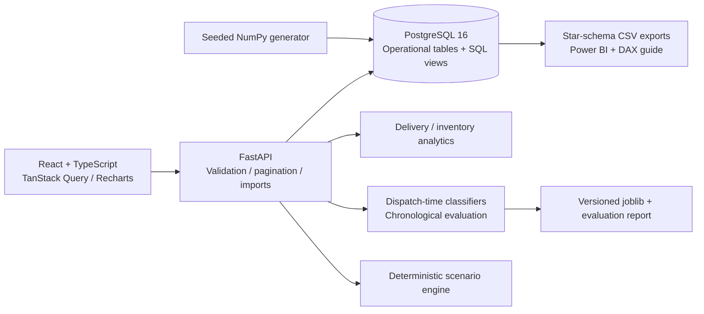

<div align="center">

# RxFlow

### Pharmacy Delivery & Supply Chain Intelligence

**From operational data to faster, smarter medicine fulfilment.**

[](https://github.com/abhinavgautam121/RxFlow/actions/workflows/ci.yml)


[Business case](docs/business-case.md) · [Architecture](docs/architecture.md) · [Metric definitions](docs/methodology.md) · [5-minute demo](docs/demo-script.md) · [Validation evidence](docs/validation.md)

</div>

RxFlow is a working full-stack portfolio project for investigating delivery reliability, inventory exposure and operational trade-offs in a hypothetical Indian e-pharmacy. It connects a reproducible dataset, PostgreSQL, Python analytics, machine learning and a nine-page React application.

**Independent project by [Abhinav Gautam](https://github.com/abhinavgautam121). All organisations, products, records and zone identifiers are fictional. There is no affiliation with PlatinumRx or another pharmacy.**

## Why this project

Operations teams need more than charts: they need reliable definitions, traceable evidence and a way to examine an intervention before acting. RxFlow follows a complete analytical workflow:

**Monitor → Identify → Investigate → Predict → Simulate**

For a recruiter, the most useful entry points are:

| Capability | Evidence in this repository |
|---|---|
| Business analysis | [Problem framing and decision criteria](docs/business-case.md), documented KPI populations, five intervention types |
| SQL & data modelling | [Alembic migrations](backend/alembic/versions), foreign keys and constraints, [analytical views](sql/analytical_views.sql), [CTE/window-function queries](sql/business_queries.sql) |
| Python analytics | [Delivery metrics](backend/app/analytics.py), [inventory eligibility and reorder rules](backend/app/inventory.py), SQL reconciliation tests |
| Machine learning | [Dispatch-time feature allowlist, temporal label embargo, model comparison, calibration and permutation importance](backend/app/ml.py) |
| Power BI | [Star-schema CSV exports, relationships, DAX and report design](powerbi/README.md) |
| Software engineering | React/TypeScript, FastAPI/OpenAPI, PostgreSQL, staged imports, Docker Compose and [CI](.github/workflows/ci.yml) |
| Communication | [Demo script](docs/demo-script.md), explicit assumptions, [limitations and roadmap](docs/roadmap.md) |

## What runs

| Workspace | Working behaviour |
|---|---|
| Executive overview | Delivery KPIs with numerators/denominators, trends, centre/city comparisons and evidence-led investigations |
| Delivery control tower | Status cohorts, lifecycle decomposition, duration distribution, paginated shipment explorer and event histories |
| Zone intelligence | Interactive illustrative point map, zone profiles, trends and configurable opportunity scoring |
| Partner scorecards | Reliability/speed/cost components, shared-cohort standardisation and comparison of up to four partners |
| Inventory intelligence | Sellable-stock eligibility, days of cover, stock-out exposure, pack-rounded reorder suggestions, expiry windows and FEFO |
| Predictive analytics | Three classifier baselines, chronological evaluation, calibration, active risk queue and validated prediction form |
| Demand planning | Moving-average, weekday and exponential-smoothing baselines, fixed-origin holdout, MAE/WAPE and empirical uncertainty bands |
| Simulation lab | Partner allocation, dispatch improvement, zone pilots, replenishment and centre capacity; save/revisit/compare/export |
| Data quality centre | Quality findings, downloadable reports/templates, authenticated atomic CSV staging and import audit trail |
| Methodology | Definitions, data scope, assumptions, feature availability and interpretation limits |

No dashboard results are hardcoded. The values below are a reproducible **synthetic baseline**, rather than a claim about a real business.

## Measured demonstration results

Default dataset: **seed 42**, 180-day history, fixed snapshot **12 November 2026, 05:30 IST**.

| Dataset | Rows |
|---|---:|
| Orders / shipments | 30,000 / 30,000 |
| Order items | 44,866 |
| Shipment events | 228,596 |
| Zones / fulfilment centres / delivery partners | 120 / 5 / 8 |
| Fictional SKUs / batches / suppliers | 300 / 1,000 / 30 |

| Operational measurement | Result |
|---|---:|
| Eligible delivered shipments | 27,706 |
| On-time delivery | **66.54%** — 18,435 / 27,706 |
| Delivered late | 9,271 |
| Currently overdue active shipments | 23 |
| Mean creation-to-delivery time | 24.56 hours |
| First-attempt success | 89.42% — 25,577 / 28,604 attempted shipments |

Late completed deliveries and currently overdue active shipments are separate populations. The generated service gaps are deliberate opportunities for investigation, not evidence about any actual pharmacy.

### Classifier evaluation

Only completed, eligible shipments create labels. Chronological windows are 60% training / 20% validation / 20% test, with boundary records removed unless their outcomes were already observable. The test set contains **5,542 shipments**, with a **33.11% delay share**.

| Model | Test ROC-AUC | Test PR-AUC | Precision | Recall | F1 | Brier |
|---|---:|---:|---:|---:|---:|---:|
| Rule baseline | 0.582 | 0.377 | 0.413 | 0.557 | 0.474 | 0.298 |
| **Logistic regression — selected** | **0.926** | **0.896** | **0.814** | **0.773** | **0.793** | **0.092** |
| Random forest | 0.925 | 0.892 | 0.798 | 0.778 | 0.788 | 0.096 |

Selection uses validation PR-AUC; decision thresholds use validation F1. No delivery outcome, final attempt count or post-dispatch event enters the feature set. Permutation importance is global association, not individual causal attribution. Synthetic holdout performance does not establish real-world utility.

Full, machine-readable measurements: [docs/evidence.json](docs/evidence.json).

## Run with Docker

Requires Git and Docker Engine/Desktop with Compose v2. The default configuration binds services to localhost.

```bash
git clone https://github.com/abhinavgautam121/RxFlow.git
cd RxFlow
cp .env.example .env
# Replace ADMIN_API_KEY in .env with a long random value before using imports.
docker compose up --build -d
docker compose ps
```

The backend migrates PostgreSQL, generates the fictional data, trains models and launches the API. First startup takes longer than subsequent starts; follow `docker compose logs -f backend` until it is healthy. Existing records are preserved on restart.

- Application: **http://localhost:8080**
- API reference: **http://localhost:8000/docs**
- Health: **http://localhost:8000/health**

```bash
docker compose down                  # stop; database and models remain in volumes
```

See [deployment and local development](docs/deployment.md) for individual services, smaller datasets, port conflicts and environment variables.

## Architecture



[Detailed architecture and ER diagram](docs/architecture.md)

```text
backend/
  app/                  API, models, generator, analytics, ML, imports, simulation
  alembic/              PostgreSQL schema and analytical-view migrations
  tests/                Formula, leakage, integrity and integration tests
frontend/
  src/pages/            React workspaces connected to the API
  src/components/       Reusable evidence tables, charts and shadcn-style controls
  tests/                Playwright acceptance flows and screenshot capture
sql/                    Analytical views and business investigations
powerbi/                Star-schema relationships, DAX and report guide
data/templates/         Importable UTF-8 CSV schemas
docs/                   Case study, methodology, demo and validation evidence
```

## Validate

```bash
# After docker compose up --build -d
docker compose exec backend python -m pytest -q
docker compose exec backend ruff check .
docker compose exec backend ruff format --check .

cd frontend
npm ci
npm test
npm run build
npx playwright install chromium
npm run test:e2e
```

The automated suite covers metric populations, inventory eligibility, reorder rounding, SQL reconciliation, temporal feature leakage, model persistence, prediction bounds, scenario reproducibility, CSV atomicity, foreign keys, filters and exports. [Validation status](docs/validation.md) distinguishes executed checks from pending checks.

The GitHub workflow runs browser acceptance and captures **actual application screenshots** as the `rxflow-evidence` artifact. See [screenshot instructions](docs/screenshots/README.md); no illustrative mockup is presented as a tested screenshot.

## Power BI workflow

Use **Data quality centre → Export Power BI ZIP**, or:

```bash
curl -f http://localhost:8000/api/v1/exports/powerbi -o rxflow-powerbi.zip
```

Import the dimension/fact CSVs into Power BI Desktop and apply the documented relationships and measures. A native `.pbix` is not included. [Power BI guide →](powerbi/README.md)

## Scope and limitations

- This is an independent portfolio implementation, not a validated production pharmacy system.
- There is no clinical decision support, prescription data, patient information or medicine-substitution advice.
- Inventory is a snapshot; movement history does not reconstruct full historical balances. Balance imports use batch-level stock snapshots, not an overwrite endpoint.
- Partner capacity is unknown. Allocation scenarios expose that limitation rather than inventing a constraint. Capacity scenarios show workload exposure without assuming a causal delivery benefit.
- Probabilities are uncalibrated; calibration is measured, not guaranteed. Forecast uncertainty bands are empirical. Forecast baseline selection uses the reported holdout and is exploratory rather than an independent second test.
- Imports use an admin key; wider deployment requires user-level access control, rate limits, retention controls and monitoring. All demo scenario writes are local-workspace operations.
- Dataset-sized pandas queries and bounded inventory tables suit this demonstration. Large production datasets need incremental aggregates and server-side inventory pagination.
- Screenshots and browser acceptance status depend on an actual browser run; see the validation record.

See [roadmap](docs/roadmap.md) for the next engineering steps.

## Author

**Abhinav Gautam** · Data Analyst / Business Analyst portfolio  
[GitHub profile](https://github.com/abhinavgautam121)

Licensed under [MIT](LICENSE).
