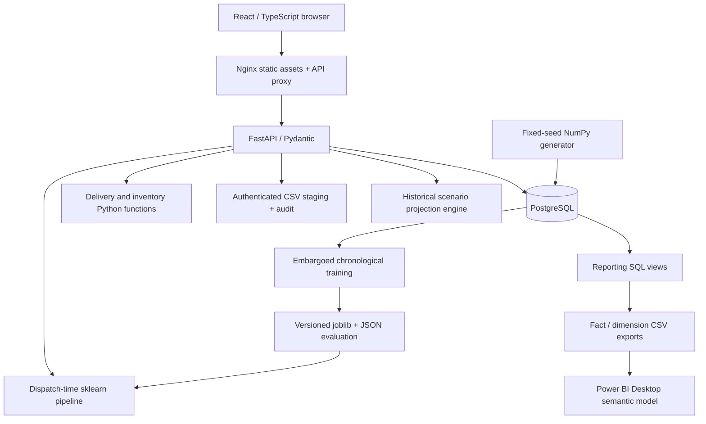
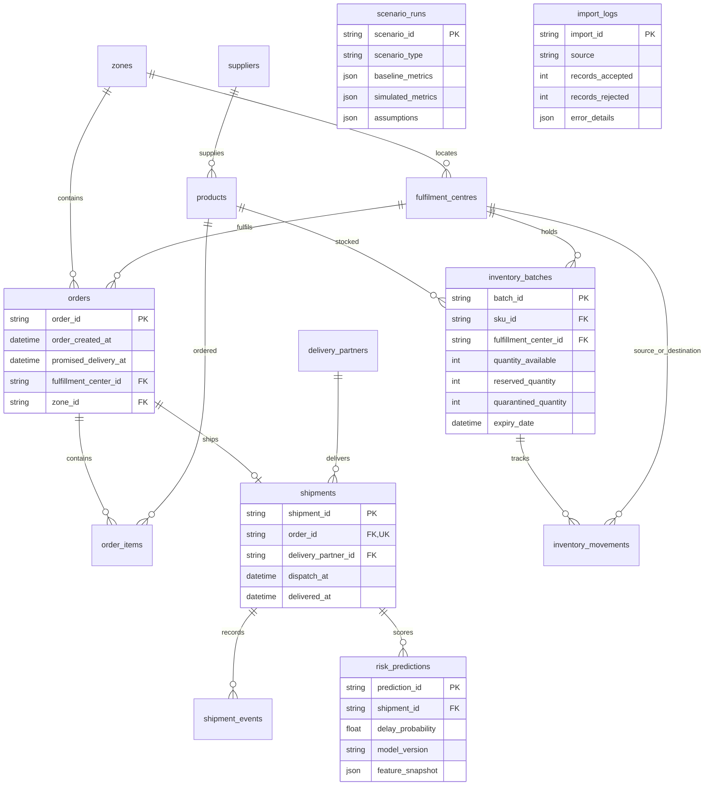

# Architecture and data model

React renders nine route workspaces. TanStack Query manages request state and cohort filters. The frontend accesses FastAPI only; it never connects to PostgreSQL. Nginx serves the production assets and proxies `/api/`. FastAPI validates requests and uses SQLAlchemy 2. Alembic creates constrained operational tables and PostgreSQL reporting views. The generator and classifiers run on first startup and preserve existing data on restart.

## Entity relationships

`scenario_runs`, `import_logs` and `dataset_meta` are independent audit/configuration tables. One shipment per order is enforced; split shipments would require relaxing that constraint and revising order-level SLA denominators.

## Integrity and indexes

- Primary keys and unique references reject duplicates. Foreign keys protect zone, centre, supplier, SKU, order, shipment and batch relationships.
- Quantity constraints prevent negative stock, over-fulfilment, reservations above on-hand and invalid prediction probabilities.
- Indexes support creation date, centre, zone, partner, shipment status, batch expiry and shipment-event time lookups.
- Timestamp columns are timezone-aware PostgreSQL timestamps. Date filters use inclusive Asia/Kolkata calendar dates converted to a UTC half-open interval.
- API query values use SQLAlchemy-bound parameters. Import table/column names come from a fixed allowlist, never user-provided SQL.

## Performance and deployment boundaries

The 30,000-order demonstration uses database joins followed by reusable pandas functions. This keeps formula logic visible and testable. It is not a claim of production-scale query performance. A larger deployment should move stable aggregates into SQL/materialised views, add incremental ingestion, implement server-side inventory pagination and separate model retraining from web-server startup.

The specified Python/PostgreSQL service runs in Docker. A static site host or Cloudflare Worker alone cannot run this architecture; no reduced static dashboard is substituted for the backend.
