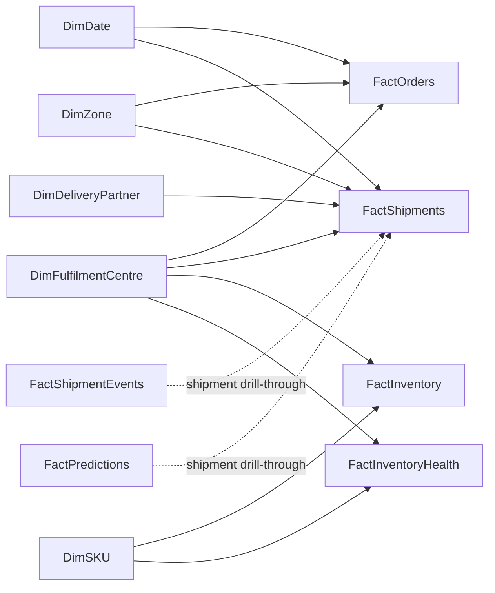

# Power BI integration

This repository provides clean fact/dimension CSVs, an explicit relationship design, DAX suggestions and PostgreSQL analytical views. A native Power BI Desktop `.pbix` file is not included or claimed.

## Generate exports

With the application running, use **Data quality centre → Export Power BI ZIP**, or:

```bash
curl -f http://localhost:8000/api/v1/exports/powerbi -o rxflow-powerbi.zip
```

For individual CSVs from local development:

```bash
cd backend
../.venv/bin/python -m app.exports
```

This writes ignored runtime files to `powerbi/exports/`. Templates are tracked in `data/templates/`; data are regenerated rather than committed as large binaries.

## Star-schema grain and relationships

| Export | Grain | Principal relationships |
|---|---|---|
| DimDate | One local calendar day, integer DateKey | FactOrders / FactShipments.DateKey |
| DimZone | One fictional zone | Orders / Shipments.zone_id |
| DimFulfilmentCentre | One centre | Orders / Shipments / Inventory / InventoryHealth.fulfillment_center_id |
| DimDeliveryPartner | One partner | FactShipments.delivery_partner_id |
| DimSKU | One fictional SKU | FactInventory / InventoryHealth.sku_id |
| FactOrders | One order | Date / Zone / Centre |
| FactShipments | One shipment, enriched with order dimensions | Date / Zone / Centre / Partner |
| FactShipmentEvents | One event | Shipment drill-through key |
| FactInventory | One batch at snapshot | SKU / Centre |
| FactInventoryHealth | One SKU–centre demand/stock pair | SKU / Centre |
| FactPredictions | One persisted inference | Shipment drill-through key |
| FactScenarioRuns | One saved scenario | Independent scenario audit table |

Use one-to-many, single-direction dimension filters. Do not create competing active date/zone/centre paths through both FactOrders and FactShipments. Keep operational order/shipment IDs available for drill-through; avoid bidirectional many-to-many relationships. Category/SKU order analysis would additionally need an order-item bridge export before filtering order facts by SKU.



## Import types

Set DateKey/quantities to whole numbers, values/costs/hours/probabilities to decimal numbers, timestamps to Date/Time/Timezone in Power Query, and EligibleDelivered/OnTime/stockout_risk/first_attempt_success to true/false. Interpret all source timestamps as UTC; local date keys already use Asia/Kolkata. `quantity_available` is recorded on hand, before reservations. FactInventory includes calculated SellableUnits and NearExpiryValue.

## Suggested DAX

```dax
Total Orders = COUNTROWS(FactOrders)

Delivered Orders =
CALCULATE(COUNTROWS(FactShipments), FactShipments[shipment_status] = "DELIVERED")

Eligible Delivered =
CALCULATE(COUNTROWS(FactShipments), FactShipments[EligibleDelivered] = TRUE())

On-Time Orders =
CALCULATE(COUNTROWS(FactShipments), FactShipments[OnTime] = TRUE())

On-Time Delivery % = DIVIDE([On-Time Orders], [Eligible Delivered])

Average Delivery Hours =
CALCULATE(AVERAGE(FactShipments[DeliveryHours]), FactShipments[EligibleDelivered] = TRUE())

Delayed Shipments = [Eligible Delivered] - [On-Time Orders]

Attempted Shipments =
CALCULATE(COUNTROWS(FactShipments), FactShipments[delivery_attempt_count] > 0)

First Attempt Success % =
DIVIDE(
  CALCULATE(COUNTROWS(FactShipments), FactShipments[delivery_attempt_count] > 0,
    FactShipments[first_attempt_success] = TRUE()),
  [Attempted Shipments]
)

SDD Share = DIVIDE(
  CALCULATE(COUNTROWS(FactOrders), FactOrders[promised_service_level] = "SDD"),
  [Total Orders]
)

NDD Share = DIVIDE(
  CALCULATE(COUNTROWS(FactOrders), FactOrders[promised_service_level] = "NDD"),
  [Total Orders]
)

Cost per Successful Delivery =
DIVIDE(SUM(FactShipments[shipping_cost]), [Eligible Delivered])

Sellable Units = SUM(FactInventory[SellableUnits])

Stock-out Risk SKU Count =
CALCULATE(DISTINCTCOUNT(FactInventoryHealth[sku_id]),
  FactInventoryHealth[stockout_risk] = TRUE())

Near-Expiry Inventory Value = SUM(FactInventory[NearExpiryValue])
```

Format shares as percentages. Keep denominators in tooltips. Blank division results mean no eligible population, not zero service. Verify these measures in Power BI Desktop after importing and compare with API/SQL values; DAX has been supplied as integration guidance, not executed by a DAX engine in this environment.

## Four-page report plan

1. **Executive:** order volume, on-time numerator/denominator, delivered-late versus currently-overdue, daily trends, region/centre slicers.
2. **Delivery & partners:** lifecycle sample sizes, comparable cohorts, cost per success, first-attempt success, zone/partner drill-through. Raw performance charts must retain the operating-mix limitation.
3. **Inventory:** sellable stock, lead-time coverage, near-expiry value, centre/SKU filters, FEFO batch table. Keep snapshot metrics separate from order-date slicers.
4. **Risk & scenarios:** model version, delay probability bands, confusion/calibration summaries, baseline-versus-projection scenario table. JSON scenario assumptions can be expanded in Power Query.

SQL views available for direct PostgreSQL reporting: daily KPIs, partner, zone, centre, inventory health, demand, delay risk and monthly trends. See [analytical_views.sql](../sql/analytical_views.sql).
